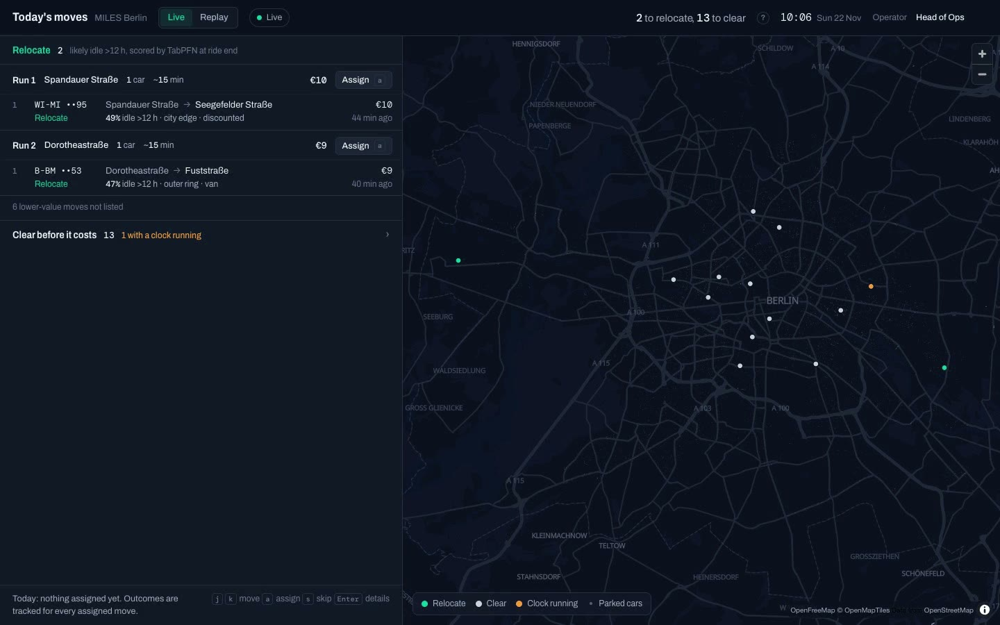

# MILES x Rescue: predicting which free-floating cars will strand, with TabPFN

When a car-sharing ride ends, we predict whether the car will then sit unrented for more than 12 hours
("strand"). The cars most likely to strand can be moved early: by a nearby rider for a small credit, or by the
operator's own staff a day sooner than today.

This is open applied research and a feature we think MILES should build. It is free to use (Apache-2.0).
It is **unofficial and not affiliated with or endorsed by MILES Mobility**. MILES did not take part.

- Landing page: <https://miles.bolls.dev/>
- Whitepaper (PDF): <https://miles.bolls.dev/whitepaper/whitepaper.pdf> (source in [`whitepaper/latex/`](whitepaper/latex/))
- Operator console: <https://miles.bolls.dev/ops/>
- Concept rider app (PWA): <https://miles.bolls.dev/app/>

Authors: Linus Bolls, Carolina Blasco. Built at Prior Labs HACKLAB #2 (CIC Berlin, November 2026). All model results
are on historical Berlin data from June 2024.

## The problem

In Berlin in June 2024 about **2,700 ride ends per day (18%)** were followed by more than 12 hours idle
([`rescue_stranded_validation.md`](miles-ops/analysis/rescue_stranded_validation.md): 53,616 of 301,995 ride ends
over 20 days = 17.75%). Most of these cars are not broken; they are parked where nobody wants a car next.
MILES runs about **180 relocation trips a day**, starting a median **24.6 h** after the last customer ride. So
relocation is reactive and about a day late. (The relocation figures are inferred heuristically from the public
status record, not from operator logs; see Reproducibility.)

If stranding can be predicted at the moment a ride ends, the car can be moved before the day is lost.

## Method

- **Data.** The MILES public vehicle endpoint, as recorded by the [vorfahrt](https://github.com/koenidv/vorfahrt) project:
  position, status and fuel level of every car, every few minutes. One row per customer ride end. No user data.
- **Label.** `idle_h > 12`: hours from a ride end to the car's next status change.
- **Split.** Strictly by time: train 3-16 June 2024, test 17-22 June 2024. Data after 23 June is not used (the
  scraper's status data breaks from 24 June).
- **TabPFN.** Prior Labs API (`tabpfn-client` 0.10.1), default settings, no tuning. Its context is a uniform random
  sample (`random_state=0`) of 10,000 training ride ends, about 5% of the 208k training rows.
- **Baselines, same budget and full budget.** scikit-learn `HistGradientBoostingClassifier` (GBM) on the same 10k
  rows and on all 208k rows; logistic regression on all rows (used to explain why cars strand).
- **Metrics.** AUC (ranking), ECE with 10 equal-width bins (are the probabilities trustworthy?), and top-10% hit rate
  (the share of the 10% highest-scored ride ends that really strand; only the top of the list is acted on).
  Calibration matters because the offer rule multiplies a probability by a value in euros.

## Results

Berlin, train 3-16 June 2024, test 17-22 June 2024, base rate 17.75%. TabPFN = 10k-row context, no tuning.

| Stranding model | Training rows | AUC | ECE | Top-10% hit rate |
|---|---|---|---|---|
| Logistic regression | 208k | 0.806 | - | - |
| GBM | 10k | 0.825 | 0.030 | 54% |
| **TabPFN** | **10k** | **0.846** | **0.010** | **58%** |
| GBM | 208k (all) | 0.858 | 0.008 | 61% |

**A GBM trained on all 208k rows edges TabPFN** on accuracy and calibration. At the same 10k-row budget, TabPFN is
ahead (0.846 vs 0.825) with a third of the calibration error. We do not claim TabPFN beats the GBM on Berlin.


**Served model.** The model running live is a reduced 11-feature version (time, car, position; no local supply and
demand features). Its out-of-sample AUC on 17-22 June ride ends is **0.822**, Brier 0.112, ECE 0.015
([`miles-ops/model/tabpfn_meta.json`](miles-ops/model/tabpfn_meta.json), `metrics.tabpfn_clean_split`).

**Cold start in a new city.** Another MILES city is treated as new: models get *n* local ride ends from its first
two June weeks and are tested on its last two weeks.

| Model | n=50 | n=200 | n=1000 | Source |
|---|---|---|---|---|
| **TabPFN**, Berlin rides + local rides as context, no training | **0.665** | **0.688** | **0.710** | teammate's API run, scripts pending |
| GBM trained on Berlin only (transfer) | 0.649 | 0.647 | 0.655 | `coldstart_results_off.csv` |
| GBM trained on local rides only | 0.554 | 0.588 | 0.603 | `coldstart_results_off.csv` |

The TabPFN row and the GBM rows come from **different runs**, so the comparison is indicative until both are rerun
together. In the TabPFN run, the best same-run GBM baseline was about 0.61 at n=50 and about 0.65 at n=1000 (not run
at n=200). The figure keeps the two runs in separate panels for that reason.


Note: the older [`coldstart_results_api.csv`](miles-ops/analysis/coldstart_results_api.csv) is a small early run in
which TabPFN got **only the local rides, without Berlin context**. It scores lower (0.58 at n=50, 0.55 at n=200) and
is not the source of the row above. See
[`NOTE_coldstart_results_api.md`](miles-ops/analysis/NOTE_coldstart_results_api.md).

**Value map: where to send the car.** P(a parked car is not rented within 12 h), from hourly snapshots of parked cars,
aggregated per 1 km cell and hour. TabPFN 10k **0.777**, GBM 10k 0.762, GBM 500k **0.785** (the full-data GBM leads
again). Scripts pending.

**Still there when the rescuer arrives.** P(a flagged car is still available after a 5-30 minute walk), used to price
a money-back guarantee. TabPFN AUC **0.827**; on the test days it predicts 4.7% of cars gone against 4.6% observed.
Same-budget GBM baselines are pending. Scripts pending.

## Live deployment

- **Operator console** (<https://miles.bolls.dev/ops/>; front end in [`miles-atlas/static/ops/`](miles-atlas/static/ops/),
  API in [`miles-ops/backend/`](miles-ops/backend/)). One ranked list of today's moves: *relocate* cars likely to
  strand, and *clear* cars sitting in or heading into a paid or no-parking spot. Moves are grouped into field runs you
  assign or skip, and outcomes are stored.
  - **Live** reads real Berlin ride ends recorded from the MILES public vehicle endpoint and scores them with TabPFN through the Prior
    Labs API against the fixed June 2024 context, batched every 60 s
    ([`app/strand_tabpfn.py`](miles-ops/backend/app/strand_tabpfn.py)). If a call fails or takes over 20 s, a GBM
    scores the batch and the move says so.
  - **Replay** plays back real June 2024 ride ends with TabPFN scores **precomputed** out-of-sample by
    [`build_tabpfn.py`](miles-ops/backend/build_tabpfn.py). It is always labelled "Replay".
  - A car becomes a relocate move at p >= 0.4556 (the top 10% of ride ends; 56% of those really stranded).
- **Concept rider app** (<https://miles.bolls.dev/app/>; source in [`drive-app/`](drive-app/)): a map that badges only
  the cars predicted to strand, with a €5 offer to move one to an area where it will be rented sooner. It runs on
  **one labelled demo snapshot** of the June 2024 replay, not live data. See [`drive-app/README.md`](drive-app/README.md)
  for what is real and what is simulated.



## Reproduce

### Requirements

- Python 3.12 and `pip install -r miles-ops/analysis/requirements.txt` (analysis);
  `miles-ops/backend/requirements.txt` (console API).
- For TabPFN runs: a Prior Labs API token in `TABPFN_TOKEN`.
- For the concept app: Node 20+ and pnpm (see `drive-app/README.md`).
- For the figures: `uv run --with matplotlib --with pandas python docs/make_figures.py`.

### Data

Raw data is not in this repo. The source is Florian König's public MILES dataset (2024: Postgres metadata dump +
InfluxDB time-series backup), linked from [koenidv/vorfahrt](https://github.com/koenidv/vorfahrt) `analysis/README.md`:
<https://drive.google.com/drive/folders/12a90qLwjNpn3x2uU9DKYHmXFjsqgl4_t>.

The scripts expect this layout under the repo root (override the root with `MILES_REPO=/path`):

```
data/miles/changes/<week-start>.parquet   one file per ISO week: time, vehicle_id, city, status, latitude, longitude, charge, ...
data/miles/tables/vehicles.parquet        one row per car
data/berlin_parking/                      Berlin street-parking geodata (gdi.berlin.de WFS, dl-de/zero-2-0;
                                          see miles-ops/analysis/berlin_parking/README.md)
data/osm/Berlin.osm.pbf                   OpenStreetMap extract (parking scripts only)
```

The export from the InfluxDB backup to `data/miles/changes/*.parquet` is not yet scripted in this repo (pending).

### Steps

```bash
# 1. ride-end table for all cities (label idle_h > 12) -> miles-ops/analysis/rideends_allcities_2024-06.parquet
python miles-ops/analysis/build_rideends_allcities.py

# 2. cold-start GBM baselines -> miles-ops/analysis/coldstart_results_off.csv  (~80 s on a laptop)
python miles-ops/analysis/coldstart.py --tabpfn off
#    (--tabpfn api runs TabPFN on LOCAL rides only, no Berlin context; see NOTE_coldstart_results_api.md)

# 3. served model: 10k context, out-of-sample replay scores, metrics -> miles-ops/model/tabpfn_meta.json
#    needs the replay table from miles-ops/backend/build_replay.py and TABPFN_TOKEN
TABPFN_TOKEN=... python miles-ops/backend/build_tabpfn.py

# 4. figures -> docs/fig_*.svg|png
uv run --with matplotlib --with pandas python docs/make_figures.py
```

We reran step 2 from a fresh clone of this repo on 22 Nov 2026; the output was byte-identical to the committed
`coldstart_results_off.csv`.

### Where each number comes from

| Number | Script | Output |
|---|---|---|
| 2,700 strandings/day, 17.75% | analysis script `rescue_analysis.py`: **pending** | [`rescue_stranded_validation.md`](miles-ops/analysis/rescue_stranded_validation.md), [`rescue_stranded_aggregates.csv`](miles-ops/analysis/rescue_stranded_aggregates.csv) |
| ~180 relocations/day, median 24.6 h late | **teammate's analysis; scripts pending** | - |
| Stranding table (TabPFN 0.846, GBM 0.825 / 0.858, logistic 0.806) | **teammate's Prior Labs API rerun; scripts pending** | - |
| Served model AUC 0.822 / Brier 0.112 / ECE 0.015, threshold 0.4556 | [`build_tabpfn.py`](miles-ops/backend/build_tabpfn.py) | [`tabpfn_meta.json`](miles-ops/model/tabpfn_meta.json) |
| Cold start, TabPFN 0.665 / 0.688 / 0.710 | **teammate's Prior Labs API rerun; scripts pending** | - |
| Cold start, GBM transfer 0.649-0.655, GBM local 0.554-0.603 | [`coldstart.py --tabpfn off`](miles-ops/analysis/coldstart.py) | [`coldstart_results_off.csv`](miles-ops/analysis/coldstart_results_off.csv) |
| Value map (TabPFN 0.777, GBM 0.762 / 0.785) | **teammate's Prior Labs API rerun; scripts pending** | - |
| Still there (AUC 0.827, 4.7% vs 4.6%) | **teammate's Prior Labs API rerun; scripts pending** | - |

`tabpfn_meta.json` also holds an older teammate run (`metrics_carolina`: TabPFN 0.824, GBM 0.84) from before the
final feature set; the table above supersedes it. Its key `gbm_in_sample_replay: 0.858` is a different, **in-sample**
number (GBM fit and scored on June 3-22) that happens to round to the same value as the out-of-sample GBM-all result in
the table; it is not the source of the table's 0.858.

## Limits

- **Historical data.** All results are on June 2024. The live service scores November 2026 ride ends with a context
  that is about two and a half years older, and we have **not yet evaluated live scores against realised outcomes**.
  We trust the ranking more than the exact probability.
- **The GBM wins on full Berlin data.** For stranding and the value map, the GBM trained on all data has the higher
  AUC. TabPFN's advantages are cold start, data efficiency and calibration at equal data.
- **Cold-start rows come from different runs** (see above). Post-hoc calibration of the GBM (isotonic/Platt) was not
  evaluated and would likely narrow its calibration gap.
- **Label.** `idle_h` is time to the next status change of any kind, not strictly to the next rental.
- **No user data.** The models describe cars, places and times; they cannot personalise, and nobody knows yet how many
  riders would accept a rescue offer. The whitepaper specifies a two-week randomized experiment to measure that.
- **Stranded cars are mostly peripheral** (median 7.3 km from the centre; about 75% beyond 5 km). A walk-up rescue fits
  the inner-city share; for the rest, the operator console (staff trips a day earlier) carries more volume.
- **Concept app** runs on one demo snapshot; its "97% still there" is a fixed policy figure, not a per-car score.
- **Relocation baseline** (180/day, 24.6 h) is inferred from the public status record, not from operator logs.

## Repository layout

```
miles-ops/analysis/   labelling, training and evaluation scripts + committed result CSVs (no raw data)
miles-ops/backend/    console API (FastAPI): live TabPFN scoring with GBM fallback, replay, move generation. Dockerised.
miles-ops/model/      model metadata and metrics (tabpfn_meta.json, stranding_meta.json). Binaries not committed.
miles-atlas/static/   landing page (index.html, home/) and operator console front end (ops/), static
drive-app/            concept rider app (Expo: web PWA + iOS)
whitepaper/latex/     whitepaper source and PDF
docs/                 README figures and the script that draws them
legacy/               earlier refuel-credit prototype (/drive), dropped: stranded cars are not low on fuel
```

Not in the repo, on purpose: raw MILES data and derived parquet files, model binaries and the 10k context
(`*.joblib`, `*.npz`), replay data, real licence plates (masked as `B-MI ••NN` everywhere), and all tokens and
credentials. The live backend therefore needs a private database; the hosted links above show it running.

## License

[Apache-2.0](LICENSE). © 2026 Linus Bolls, Carolina Blasco. The MILES name is used only to describe the operator whose
public data we studied.
