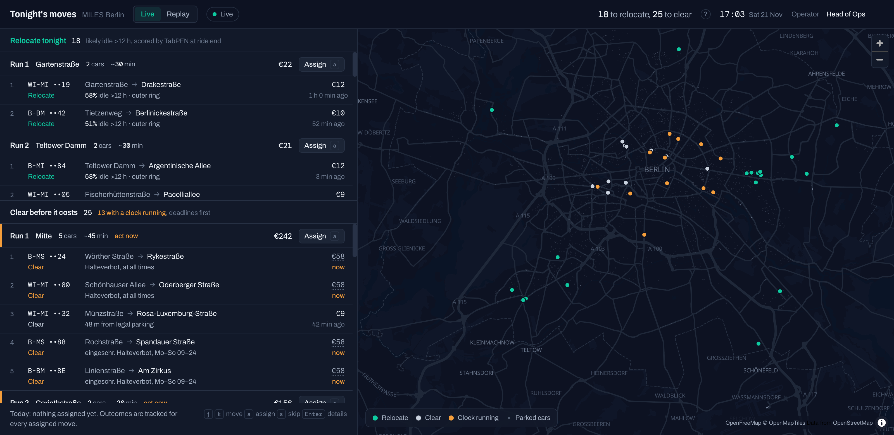
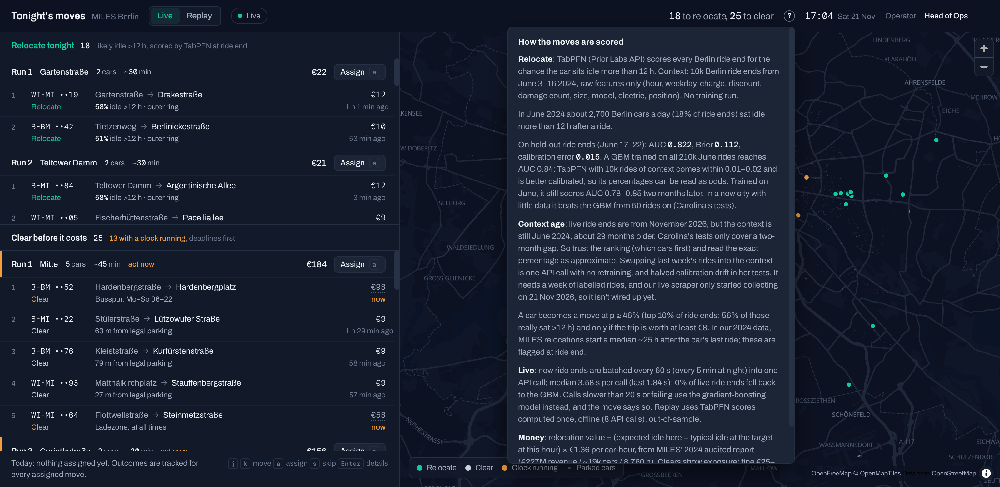
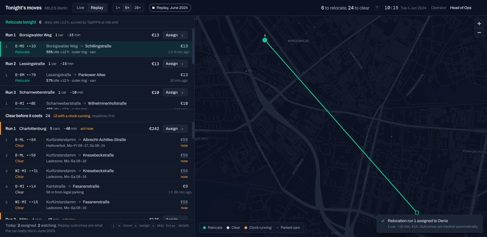
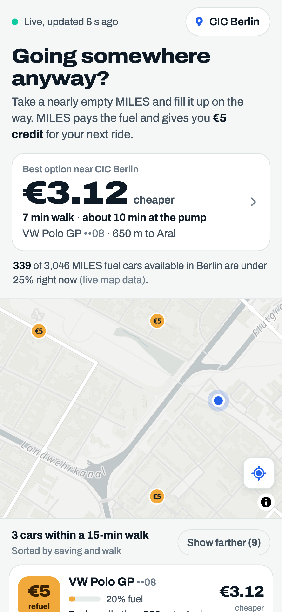

# miles-ahead

Per-ride **stranding risk scored at ride end with a tabular foundation model (TabPFN), wired to an ops action.**
When a MILES car-sharing ride ends in Berlin, we score the chance the car then sits idle for more than 12 hours, and
turn the high-risk ones — plus cars sitting in or heading into a parking restriction — into a ranked, assignable list
of moves for the field team. Built for the MILES hackathon (Prior Labs HACKLAB #2, CIC Berlin).

Two surfaces on the same data and the same models:

- **Tonight's moves** (`ops-backend/` + `ops-frontend/`, live at `miles.bolls.dev/ops`) — an operator console. One
  ranked list in two groups: *relocate* cars likely to sit idle >12 h, and *clear* cars that are in or approaching a
  paid/forbidden parking situation. Moves are grouped into field runs you assign or skip; outcomes are tracked.
- **/drive** (`drive-backend/` + `drive-frontend/`, live at `miles.bolls.dev/drive`) — a B2C phone page: nearly empty
  MILES cars near you that pay a real refuelling (€5) or charging (€10) credit, with the nearest likely partner
  station and the net saving on a trip you were taking anyway.



## The TabPFN story (honest version)

We score every Berlin ride end for *P(idle > 12 h)* with **TabPFN** (Prior Labs API) against a **fixed 10,000-row
context** of Berlin ride ends from **June 3–16 2024** (raw features only — hour, weekday, charge, discount, damage
count, size, model, electric, position). No training run; the context is the "fit".

All numbers below are reproducible from `ops-backend/model/tabpfn_meta.json` and the scripts in `analysis/`.

- **Berlin, like-for-like.** On held-out ride ends (June 17–22, scored with the June 3–16 context): **AUC 0.822,
  Brier 0.112, ECE 0.015**. A gradient-boosted model (GBM) trained on **all 210k June rides** reaches **AUC ~0.84**.
  TabPFN with **10k rows of context comes within 0.01–0.02 AUC** of that GBM and is **better calibrated** (Carolina's
  clean split: TabPFN ECE 0.008 vs. a GBM's), so its percentages can be read roughly as odds.
- **Cold start wins where it matters.** TabPFN's edge is largest in the low-data regime. In a *new city* with little
  history it beats the GBM from roughly **50 rides on** — the GBM has too few rows to fit (see `analysis/coldstart.py`
  and the committed `coldstart_results_*.csv`). This is the realistic operational case: standing up a new market.
- **Out-of-time.** The June-2024 context still ranks well about **two months later (AUC ~0.78–0.85)** in Carolina's
  tests. Live ride ends are from Nov 2026, ~29 months after the context, so we **trust the ranking (which cars
  first) and read the exact probability as approximate.** Refreshing the context with recent labelled rides is one
  API call with no retraining, but needs ~a week of labelled outcomes, so it isn't wired up live yet.

We **do not** claim to be "first to predict idle time." The contribution is a per-ride foundation-model score wired
to a concrete ops action, calibrated well enough that an operator can act on the number.



## How a ride end becomes a move

1. A customer ride ends → features at ride end (`ops-backend/app/strand_tabpfn.py`).
2. TabPFN scores *P(idle > 12 h)*; if a call is slow (>20 s) or fails, a trained GBM scores the batch and the move
   says so (`ops-backend/model/` holds the GBM + metadata; the model binary itself is not committed — see below).
3. A car becomes a **relocate** move at p ≥ ~0.46 (top 10% of ride ends; ~56% of those really sat >12 h) and only if
   the expected value clears ~€8. A car becomes a **clear** move from parking rules (paid zone, Halteverbot,
   loading/bus/taxi lane, far from legal parking), deadlines first (`ops-backend/app/rules.py`).
4. Moves are grouped into field runs, ranked, and shown with assign / skip; outcomes are stored
   (`ops-backend/app/moves.py`, `store.py`).




## What's real vs simulated

**Real**

- The GBM is trained on real Berlin ride ends, June 3–22 2024.
- TabPFN scored **real** June-2024 ride ends through the Prior Labs API: 8 offline calls, out-of-sample (June 17–22
  scored against the June 3–16 context). Every metric in `ops-backend/model/*.json` comes from those runs.
- **Replay** plays back **real** Berlin ride ends from June 3–22 2024 with those precomputed TabPFN scores, on the
  same screen and models as live. It is always labelled "Replay".
- **Live** reads **real** Berlin ride ends from our own scraper's database and scores them with TabPFN (Prior Labs
  API) against the June-2024 context, batched every 60 s.
- **/drive** reads live car fuel/charge levels scraped from the public MILES map; it never talks to MILES. Credit
  rules are quoted from the MILES help center; our pricing/saving assumptions are labelled as assumptions
  (`drive-backend/README.md`).

**Simulated / clearly labelled**

- The QA "inject event" path produces **test** events, tagged as such, for demoing the console (`ops-backend/app/qa.py`).
- Replay is sped-up playback, always labelled; nothing synthetic is ever presented as live.

**Deliberately not in this repo** (see `.gitignore`): the MILES scraper and its database, raw MILES data / parquet
dumps of car positions, real licence plates (masked to `B-MI ••NN` everywhere), the trained model binary
(`stranding_gbm.joblib`), geo/replay data artifacts, and all tokens/credentials. The live backends therefore need a
private database to run end-to-end; the hosted versions above are the way to see them live.

### Data facts

- We use **June 3–22 2024 only.** June 24 onward has broken ride labels (scraper behaviour changed).
- MILES' own 2024 audited report treats parking fees as a material variable cost; our value model uses its figures
  (€227M revenue / ~19k cars / 8,760 h → €1.36 per car-hour).

## Repository layout

```
analysis/        model + evaluation scripts (TabPFN cold-start, Berlin like-for-like, stranding, parking, fees)
                 and committed result CSVs. Raw parquet inputs are not committed.
ops-backend/     FastAPI "Parking Control" API: scoring, move generation, live + replay, QA. Dockerised.
  app/           application code
  model/         model metadata + metrics JSON (the numbers behind this README). Binary model not committed.
  geo/           public parking-zone geometry (OpenStreetMap). MILES-derived geo artifacts not committed.
ops-frontend/    "Tonight's moves" operator console (vanilla JS + MapLibre). Static.
drive-backend/   /drive API (Flask + SQLite). Dockerised.
drive-frontend/  /drive phone page (vanilla JS + MapLibre). Static.
data-science/    reserved for Carolina's TabPFN scripts (see its README).
docs/            screenshots used in this README.
```

## Running it

**Frontends** are static. Point them at a running backend and serve the folder, e.g.:

```bash
cd ops-frontend && python3 -m http.server 8000   # then open http://localhost:8000/?api=<backend-url>/ops/api
cd drive-frontend && python3 -m http.server 8001  # expects the drive API under ./api/
```

They load MapLibre and basemap tiles from public CDNs (OpenFreeMap, cdnjs) — no API keys.

**Backends** are FastAPI (ops) and Flask (drive), both Dockerised (`compose.yml` in each). They read ride and car
data from a read-only Postgres role on the private MILES scraper DB (`OPS_DB_DSN`), and the ops backend calls the
Prior Labs TabPFN API (`TABPFN_TOKEN`); if the token is absent it falls back to the GBM. Deploy scripts
(`deploy.sh`, `setup_db_role.sh`) document the production setup on the project's own host. Because the scraper DB and
tokens are private, the live path can't be reproduced from this repo alone — use the hosted sites, or wire your own
data source.

**Reproducing the model** from the June-2024 dataset: `analysis/stranding_clean.py` (GBM), `analysis/coldstart.py`
(`--tabpfn local|api|off`, cross-city cold start), `analysis/berlin_likeforlike.py` (Berlin TabPFN-vs-GBM scaling),
and `ops-backend/build_tabpfn.py` (builds the 10k context, precomputes replay scores, writes the metadata JSON).

## License

[Apache-2.0](LICENSE). © 2026 Linus Bolls.
