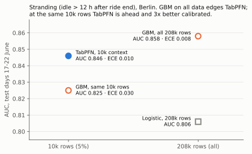
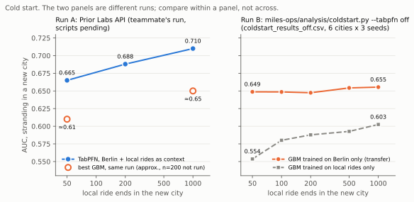

# MILES x Rescue: predicting which free-floating cars will strand, with TabPFN

When a car-sharing ride ends, we predict whether the car will then sit unrented for more than 12 hours
("strand"). The car can then be moved at the moment the ride ends, by a user who is leaving from there anyway:
they take the flagged car instead of another one, for a credit priced by where they are going. Today the operator's
staff move cars about a day late.

This is open applied research and a feature we think MILES should build. It is free to use (Apache-2.0).
It is **unofficial and not affiliated with or endorsed by MILES Mobility**. MILES did not take part.

- Landing page: <https://miles.bolls.dev/>
- Whitepaper (PDF): <https://miles.bolls.dev/whitepaper/whitepaper.pdf> (same file in the repo: [`whitepaper/latex/main.pdf`](whitepaper/latex/main.pdf); source in [`whitepaper/latex/`](whitepaper/latex/))
- Operator console: <https://miles.bolls.dev/ops/>
- Concept rider app (PWA): <https://miles.bolls.dev/app/>

Authors: Linus Bolls, Carolina Blasco. Built at Prior Labs HACKLAB #2 (CIC Berlin, November 2026). All model results
are on historical Berlin data from June 2024.

## The problem

In Berlin in June 2024 **more than 2,000 cars a day strand**: 18% of ride ends were followed by more than 12 hours idle
([`rescue_stranded_validation.md`](miles-ops/analysis/rescue_stranded_validation.md): 53,616 of 301,995 ride ends
over 20 days = 17.75%). Most of these cars are not broken; they are parked where nobody wants a car next.
MILES runs about **186 relocation trips a day**, starting a median **24.1 h** after the last customer ride
(3,724 `IN_RELOCATION_TRIP` runs, June 3-22 2024; [`relocations_june.py`](miles-ops/analysis/relocations_june.py)).
By then 80% of the cars we flag at ride end have already been rented without help. (Relocations are read from the
public status record, not from operator logs.) On rental time alone, staff moves as practised lose about
**€0.6-2.7M a year** (MILES may relocate for other reasons too). A mature hybrid (riders move flagged cars at ride end,
staff only for the predicted long tail) could save about **€0.6-3M a year in Berlin**. These are operating-model
scenarios, not a TabPFN result; the staff-vs-user economics are in [`whitepaper/value_model.md`](whitepaper/value_model.md).

If stranding can be predicted at the moment a ride ends, the car can be moved before the day is lost.

## Method

- **Data.** The MILES public vehicle endpoint, as recorded by the [vorfahrt](https://github.com/koenidv/vorfahrt) project:
  position, status and fuel level of every car, every few minutes. One row per customer ride end. No user data.
- **Label.** `idle_h > 12`: hours from a ride end to the car's next status change.
- **Split.** Strictly by time: train 3-16 June 2024, test 17-22 June 2024. Data after 23 June is not used (the
  scraper's status data breaks from 24 June).
- **TabPFN.** Prior Labs API (`tabpfn-client` 0.10.1), default settings, no tuning. Its context is a uniform random
  sample (`random_state=0`) of 10,000 training ride ends, about 5% of the 208k training rows.
- **Baselines, same budget and full budget.** scikit-learn `HistGradientBoostingClassifier` (GBM) on the same 10k
  rows and on all 208k rows; logistic regression on all rows (used to explain why cars strand).
- **Metrics.** AUC (ranking), ECE with 10 equal-width bins (are the probabilities trustworthy?), and top-10% hit rate
  (the share of the 10% highest-scored ride ends that really strand; only the top of the list is acted on).
  Calibration matters because the offer rule multiplies a probability by a value in euros.

## Results

Berlin, train 3-16 June 2024, test 17-22 June 2024 (time split; all AUCs below are on the test days), base rate 17.75%.
TabPFN = 10k-row context, no tuning.

| Stranding model | Training rows | AUC | ECE | Top-10% hit rate |
|---|---|---|---|---|
| Logistic regression | 208k | 0.806 | - | - |
| GBM | 10k | 0.825 | 0.030 | 54% |
| **TabPFN** | **10k** | **0.846** | **0.010** | **58%** |
| GBM | 208k (all) | 0.858 | 0.008 | 61% |

**A GBM trained on all 208k rows edges TabPFN** on accuracy and calibration. At the same 10k-row budget, TabPFN is
ahead (0.846 vs 0.825) with a third of the calibration error. We do not claim TabPFN beats the GBM on Berlin.



**Served model.** The model running live is a reduced 11-feature version (time, car, position; no local supply and
demand features). Its out-of-sample AUC on 17-22 June ride ends is **0.822**, Brier 0.112, ECE 0.015
([`miles-ops/model/tabpfn_meta.json`](miles-ops/model/tabpfn_meta.json), `metrics.tabpfn_clean_split`).

**Cold start in a new city.** Another MILES city is treated as new: models get *n* local ride ends from its first
two June weeks and are tested on its last two weeks.

| Model | n=50 | n=200 | n=1000 | Source |
|---|---|---|---|---|
| **TabPFN**, Berlin rides + local rides as context, no training | **0.665** | **0.688** | **0.710** | teammate's API run, scripts pending |
| GBM trained on Berlin only (transfer) | 0.649 | 0.647 | 0.655 | `coldstart_results_off.csv` |
| GBM trained on local rides only | 0.554 | 0.588 | 0.603 | `coldstart_results_off.csv` |

The TabPFN row and the GBM rows come from **different runs**, so the comparison is indicative until both are rerun
together. TabPFN's margin over the Berlin-transfer GBM is about 0.02 at n=50 and about 0.06 at n=1000. The figure
keeps the two runs in separate panels for that reason.



Note: the older [`coldstart_results_api.csv`](miles-ops/analysis/coldstart_results_api.csv) is a small early run in
which TabPFN got **only the local rides, without Berlin context**. It scores lower (0.58 at n=50, 0.55 at n=200) and
is not the source of the row above. See
[`NOTE_coldstart_results_api.md`](miles-ops/analysis/NOTE_coldstart_results_api.md).

**Value map: where to send the car.** P(a parked car is not rented within 12 h), from hourly snapshots of parked cars,
aggregated per 1 km cell and hour. TabPFN 10k **0.777**, GBM 10k 0.762, GBM 500k **0.785** (the full-data GBM leads
again). Scripts pending.

**Idle-time distribution (the value term).** TabPFN regressor of the hours until the next status change, ≈ next rental (capped at 48 h), 20k test ride ends.
At the same 10k rows TabPFN beats the GBM (sklearn `HistGradientBoostingRegressor`, quantile loss; not LightGBM): CRPS
**3.20 vs 3.36 h** (bootstrap −0.159 h [−0.175, −0.141]), 80% intervals cover 79.9% vs 74.5%. A GBM on all 210k rows with a large preset
(no hyperparameter search) is **0.7% better** (CRPS 3.18 h; +0.022 h [+0.005, +0.038]): no accuracy win on full Berlin data. P(idle > 12 h) read
from the regressor: AUC 0.832 / ECE 0.011 (dedicated classifier 0.835 / 0.013). New city (Hamburg, Düsseldorf), 50 local
rides plus Berlin context: TabPFN has the lowest CRPS at every n. Destinations are barely predictable (top-1 38.8% vs
38.5% for an origin-zone lookup), so users state them. Details: [`results/results.md`](miles-ops/analysis/results/results.md).

**Still there when the rescuer arrives.** P(a flagged car is still available after a 5-30 minute walk), used to price
a money-back guarantee. TabPFN AUC **0.827**; on the test days it predicts 4.7% of cars gone against 4.6% observed.
Same-budget GBM baselines are pending. Scripts pending.

## Live deployment

- **Operator console** (<https://miles.bolls.dev/ops/>; front end in [`miles-atlas/static/ops/`](miles-atlas/static/ops/),
  API in [`miles-ops/backend/`](miles-ops/backend/)). One ranked list of today's moves: *relocate* cars likely to
  strand, and *clear* cars sitting in or heading into a paid or no-parking spot. Moves are grouped into field runs you
  assign or skip, and outcomes are stored.
  - **Live** reads real Berlin ride ends recorded from the MILES public vehicle endpoint and scores them with TabPFN through the Prior
    Labs API against the fixed June 2024 context, batched every 60 s
    ([`app/strand_tabpfn.py`](miles-ops/backend/app/strand_tabpfn.py)). If a call fails or takes over 20 s, a GBM
    scores the batch and the move says so.
  - **Replay** plays back real June 2024 ride ends with TabPFN scores **precomputed** out-of-sample by
    [`build_tabpfn.py`](miles-ops/backend/build_tabpfn.py). It is always labelled "Replay".
  - A car becomes a relocate move at p >= 0.4556 (the top 10% of ride ends). On the 17-22 June test days
    57% of flagged cars really strand, 3x the 18% base rate (served 11-feature model).
- **Concept rider app** (<https://miles.bolls.dev/app/>; source in [`drive-app/`](drive-app/)): a map that badges only
  the cars predicted to strand. The user picks where they are going; the app ranks nearby flagged cars by a credit
  (≤ €5) priced from the idle hours the move saves. It runs on
  **one labelled demo snapshot** of the June 2024 replay, not live data. See [`drive-app/README.md`](drive-app/README.md)
  for what is real and what is simulated.


## Reproduce

### Requirements

- Python 3.12 and `pip install -r miles-ops/analysis/requirements.txt` (analysis);
  `miles-ops/backend/requirements.txt` (console API).
- For TabPFN runs: a Prior Labs API token in `TABPFN_TOKEN`.
- For the concept app: Node 20+ and pnpm (see `drive-app/README.md`).
- For the figures: `uv run --with matplotlib --with pandas python docs/make_figures.py`.

### Data

**Included: derived June 2024 files (48 MB in total), so the core numbers rerun without the raw dump.** All are car-level
(vehicle id, position, timestamps, car attributes); no people, users or licence plates.

| File | Rows | Range | Built by |
|---|---|---|---|
| `miles-ops/analysis/rideends_allcities_2024-06.parquet` | 782,727 ride ends, 11 cities (353,360 Berlin) | 3-30 June 2024 | [`build_rideends_allcities.py`](miles-ops/analysis/build_rideends_allcities.py) |
| `miles-ops/analysis/relocations_berlin_2024-06.parquet` | 3,724 staff relocation trips | 3-22 June 2024 | [`relocations_june.py`](miles-ops/analysis/relocations_june.py) |
| `miles-ops/analysis/parks_outcomes_berlin_2024-06.parquet` | 306,538 Berlin parking periods with street-parking context | 3-30 June 2024 | [`parking_outcomes.py`](miles-ops/analysis/parking_outcomes.py), [`parking_offstreet.py`](miles-ops/analysis/parking_offstreet.py) |
| `miles-ops/analysis/rides_damage_berlin_2024-06.parquet` | 294,296 Berlin rides | 3-30 June 2024 | [`damage_rides.py`](miles-ops/analysis/damage_rides.py) |
| `miles-ops/model/tabpfn_context.npz` | 10,000 rows x 11 features: the served TabPFN context (Berlin ride ends 3-16 June, label idle > 12 h) | 3-16 June 2024 | [`build_tabpfn.py`](miles-ops/backend/build_tabpfn.py) |
| `miles-ops/model/cells_berlin.parquet` | 1,901 Berlin grid cells (historical starts, median idle) | 3-16 June 2024 | [`export_model.py`](miles-ops/analysis/export_model.py) |

They are derived from Florian König's public MILES dataset (2024: Postgres metadata dump + InfluxDB time-series
backup, 3.9 GB), linked from [koenidv/vorfahrt](https://github.com/koenidv/vorfahrt) `analysis/README.md`:
<https://drive.google.com/drive/folders/12a90qLwjNpn3x2uU9DKYHmXFjsqgl4_t>.

**Rerun directly from the included files** (`pip install -r miles-ops/analysis/requirements.txt`, from the repo root):

```bash
# stranding base rate 17.75% (2,681/day), 186 relocations/day, median 24.1 h late  (a few seconds)
python miles-ops/analysis/headline_numbers.py

# cold-start GBM baselines -> miles-ops/analysis/coldstart_results_off.csv  (no API; minutes, not seconds)
python miles-ops/analysis/coldstart.py --tabpfn off
```

With a Prior Labs token (`TABPFN_TOKEN`) and `pip install tabpfn-client==0.10.1` in a separate environment (it pins pyarrow ≤ 25.0.1), these also run from the included files: `value_tabpfn.py` (E1),
`dest_tabpfn.py` (E2), `coldstart_value.py` (E3), `coldstart.py --tabpfn api`. `build_tabpfn.py`, `ab_scenarios.py`,
`rescue_ab_value.py` and `weak_points.py` also need the replay table (`miles-ops/backend/build_replay.py`), which is
not included.

**Rebuilding the derived files from the raw dump.** The scripts expect this layout under the repo root (override the root with `MILES_REPO=/path`):

```
data/miles/changes/<week-start>.parquet   one file per ISO week: time, vehicle_id, city, status, latitude, longitude, charge, ...
data/miles/tables/vehicles.parquet        one row per car
data/berlin_parking/                      Berlin street-parking geodata (gdi.berlin.de WFS, dl-de/zero-2-0;
                                          see miles-ops/analysis/berlin_parking/README.md)
data/osm/Berlin.osm.pbf                   OpenStreetMap extract (parking scripts only)
```

The export from the InfluxDB backup to `data/miles/changes/*.parquet` is not yet scripted in this repo (pending).

### Steps

```bash
# 1. ride-end table for all cities (label idle_h > 12) -> miles-ops/analysis/rideends_allcities_2024-06.parquet
python miles-ops/analysis/build_rideends_allcities.py

# 2. cold-start GBM baselines -> miles-ops/analysis/coldstart_results_off.csv  (~80 s on a laptop)
python miles-ops/analysis/coldstart.py --tabpfn off
#    (--tabpfn api runs TabPFN on LOCAL rides only, no Berlin context; see NOTE_coldstart_results_api.md)

# 3. served model: 10k context, out-of-sample replay scores, metrics -> miles-ops/model/tabpfn_meta.json
#    needs the replay table from miles-ops/backend/build_replay.py and TABPFN_TOKEN
TABPFN_TOKEN=... python miles-ops/backend/build_tabpfn.py

# 4. figures -> docs/fig_*.svg|png
uv run --with matplotlib --with pandas python docs/make_figures.py
```

We reran step 2 from a fresh clone of this repo on 22 Nov 2026; the output was byte-identical to the committed
`coldstart_results_off.csv`.

### Where each number comes from

| Number | Script | Output |
|---|---|---|
| More than 2,000 strandings/day, 17.75% of ride ends | [`headline_numbers.py`](miles-ops/analysis/headline_numbers.py) (from `rideends_allcities_2024-06.parquet`) | [`rescue_stranded_validation.md`](miles-ops/analysis/rescue_stranded_validation.md), [`rescue_stranded_aggregates.csv`](miles-ops/analysis/rescue_stranded_aggregates.csv) |
| 186 relocations/day, median 24.1 h late | [`relocations_june.py`](miles-ops/analysis/relocations_june.py); recheck with [`headline_numbers.py`](miles-ops/analysis/headline_numbers.py) | `relocations_berlin_2024-06.parquet` (committed) |
| Staff vs user economics, annual scenarios | [`rescue_ab_value.py`](miles-ops/analysis/rescue_ab_value.py), [`ab_economics.py`](miles-ops/analysis/ab_economics.py), [`ab_scenarios.py`](miles-ops/analysis/ab_scenarios.py) | [`value_model.md`](whitepaper/value_model.md) |
| Nov 2026 out-of-time test (AUC 0.763, context refresh +0.012) | [`oot_2026.py`](miles-ops/analysis/oot_2026.py) | [`results/oot_2026.md`](miles-ops/analysis/results/oot_2026.md) |
| Idle-time regression, CRPS 3.20 vs 3.36 / 3.18 h (E1) | [`value_tabpfn.py`](miles-ops/analysis/value_tabpfn.py) | [`results/value_e1_metrics.csv`](miles-ops/analysis/results/value_e1_metrics.csv), [`value_e1_bootstrap.csv`](miles-ops/analysis/results/value_e1_bootstrap.csv) |
| Destination model, top-1 38.8% vs lookup 38.5% (E2) | [`dest_tabpfn.py`](miles-ops/analysis/dest_tabpfn.py) | [`results/dest_e2_metrics.csv`](miles-ops/analysis/results/dest_e2_metrics.csv) |
| Value-term cold start, Hamburg / Düsseldorf (E3) | [`coldstart_value.py`](miles-ops/analysis/coldstart_value.py) | [`results/value_e3_coldstart.csv`](miles-ops/analysis/results/value_e3_coldstart.csv) |
| Stranding table (TabPFN 0.846, GBM 0.825 / 0.858, logistic 0.806) | **teammate's Prior Labs API rerun; scripts pending** | - |
| Served model AUC 0.822 / Brier 0.112 / ECE 0.015, threshold 0.4556 | [`build_tabpfn.py`](miles-ops/backend/build_tabpfn.py) | [`tabpfn_meta.json`](miles-ops/model/tabpfn_meta.json) |
| Cold start, TabPFN 0.665 / 0.688 / 0.710 | **teammate's Prior Labs API rerun; scripts pending** | - |
| Cold start, GBM transfer 0.649-0.655, GBM local 0.554-0.603 | [`coldstart.py --tabpfn off`](miles-ops/analysis/coldstart.py) | [`coldstart_results_off.csv`](miles-ops/analysis/coldstart_results_off.csv) |
| Value map (TabPFN 0.777, GBM 0.762 / 0.785) | **teammate's Prior Labs API rerun; scripts pending** | - |
| Still there (AUC 0.827, 4.7% vs 4.6%) | **teammate's Prior Labs API rerun; scripts pending** | - |

`tabpfn_meta.json` also holds an older teammate run (`metrics_carolina`: TabPFN 0.824, GBM 0.84) from before the
final feature set; the table above supersedes it. Its key `gbm_in_sample_replay: 0.858` is a different, **in-sample**
number (GBM fit and scored on June 3-22) that happens to round to the same value as the out-of-sample GBM-all result in
the table; it is not the source of the table's 0.858.

## Limits

- **Historical data.** All results are on June 2024. The live service scores November 2026 ride ends with a context
  that is about two and a half years older. On real Nov 2026 ride ends (one Saturday, n = 2,563) the frozen June
  context reaches AUC 0.763 [0.733-0.792], ECE 0.033, a tie with the GBM fallback (0.770); refreshing the context with
  fresh rows adds +0.012 AUC without retraining ([`results/oot_2026.md`](miles-ops/analysis/results/oot_2026.md)).
- **The GBM wins on full Berlin data.** For stranding and the value map, the GBM trained on all data has the higher
  AUC; for the idle-time regression a large-preset GBM (no hyperparameter search) on 210k rows has 0.7% lower CRPS (significant). TabPFN's advantages
  are cold start, data efficiency and calibration at equal data.
- **E1-E3 caveats.** The regressor is validated at ride-end positions, not at relocation targets. The value-term cold
  start has no Berlin+local GBM baseline and no CIs (3 seeds). The TabPFN API cache (`results/cache/`, 40 MB) is not
  committed, so a rerun of E1-E3 needs `TABPFN_TOKEN`.
- **Cold-start rows come from different runs** (see above). Post-hoc calibration of the GBM (isotonic/Platt) was not
  evaluated and would likely narrow its calibration gap.
- **Label.** `idle_h` is time to the next status change of any kind, not strictly to the next rental.
- **No user data.** The models describe cars, places and times; they cannot personalise, and nobody knows yet how many
  riders would accept a rescue offer, or how many rescuers would have rented another MILES car anyway. The whitepaper
  specifies a randomized experiment to measure both.
- **Stranded cars are mostly peripheral** (median 7.3 km from the centre; about 75% beyond 5 km). A good area within
  1 km exists for only 4.6% of flagged cars, which is why the rescue is "take it where you're going anyway", not a
  short walk-and-park.
- **Concept app** runs on one demo snapshot; its "97% still there" is a fixed demo value, not a per-car score. The policy behind it: only cars with a predicted
  P(still there) of at least 95% are offered (≥95% still there); then about 1.2% of rescues find the car gone.
- **Relocation baseline** (186/day, 24.1 h) is read from the public status record, not from operator logs.

## Repository layout

```
miles-ops/analysis/   labelling, training and evaluation scripts + committed result CSVs (no raw data)
miles-ops/backend/    console API (FastAPI): live TabPFN scoring with GBM fallback, replay, move generation. Dockerised.
miles-ops/model/      model metadata and metrics, the 10k TabPFN context and the cell table. Model binaries not committed.
miles-atlas/static/   landing page (index.html, home/) and operator console front end (ops/), static
drive-app/            concept rider app (Expo: web PWA + iOS)
whitepaper/latex/     whitepaper source and PDF
docs/                 README figures and the script that draws them
legacy/               earlier refuel-credit prototype (/drive), dropped: stranded cars are not low on fuel
```

Not in the repo, on purpose: the raw MILES dump (download it from the Drive link above), model binaries
(`*.joblib`), replay data, real licence plates (masked as `B-MI ••NN` everywhere), and all tokens and
credentials. The live backend therefore needs a private database; the hosted links above show it running.

## License

[Apache-2.0](LICENSE). © 2026 Linus Bolls, Carolina Blasco. The MILES name is used only to describe the operator whose
public data we studied.
