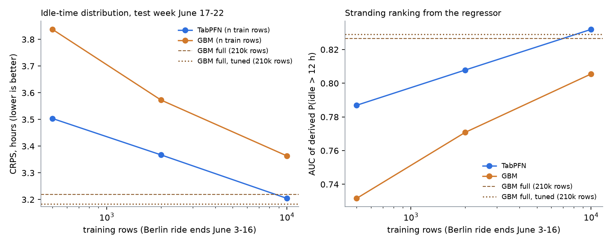
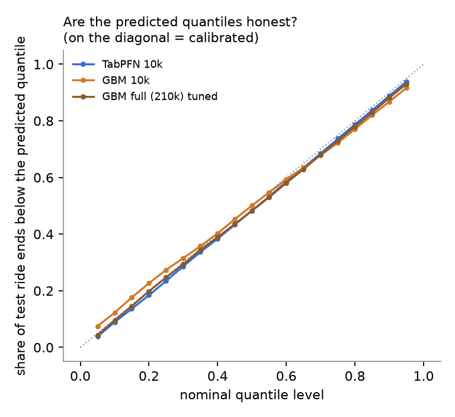
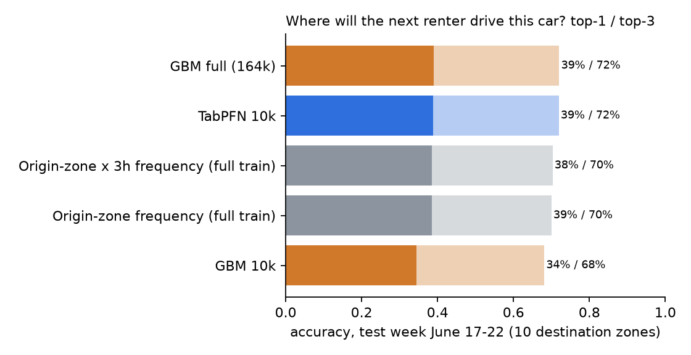
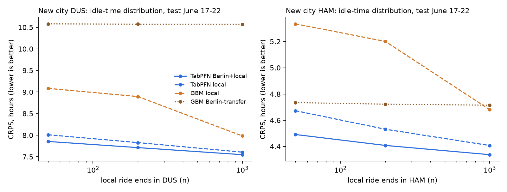

# TabPFN for the value term and destinations (E1–E3)

Berlin, MILES ride ends from June 2024. The split is by time only: context and training data are ride ends from June 3–16, the test set is June 17–22, and the data is cut at June 23 00:00. All TabPFN numbers come from the Prior Labs API through `tabpfn-client 0.10.1`, which is the pinned client (the server chooses the model version, `auto`). The GBM baseline is sklearn `HistGradientBoosting`, because LightGBM would not load on this machine (libomp is missing). Every number below is in a CSV next to this file.

Scripts: `../value_tabpfn.py` (E1), `../dest_tabpfn.py` (E2), `../coldstart_value.py` (E3). API outputs are cached locally in cache/ (not committed, 40 MB); without it a rerun needs TABPFN_TOKEN.

## E1: how long the car stands idle (the V term)

Target: idle_h, the hours from a ride end until the car's next status change (≈ next rental; 88% of stranded waits end in a booking or ride), **capped at 48 h**. The label is the same as the stranding label; the AUCs differ slightly from the stranding table because the features exclude local supply and demand and the test set is a 20k subsample. Only 0.6% of test rows hit the cap. Test set: 20,000 random ride ends from the test week, which has 90,268 in total.
Features are only those known at the ride end. **base** is the 11 raw features of the live stranding classifier. **+demand** adds two counts for the ~1.5 km square around the car: rental starts in the previous 24 h, and cars currently parked and free. The demand counts are truncated on June 3, where the data begins.
TabPFN uses a 10k random context (`random_state=0`, the same rows as the live classifier). Its predictive distribution is read out as 19 quantiles (0.05…0.95). The GBM fits quantile loss at the same 19 levels. "large preset" (model names ending in "tuned" in the CSVs; no hyperparameter search) means 1,000 iterations, learning rate 0.1, 63 leaves and early stopping. That setting was chosen in advance, with no search on the test set.

| Model (base features) | Train rows | CRPS h ↓ | MAE h ↓ | RMSE h ↓ | pinball q.1 / q.5 / q.9 ↓ | 80% interval coverage | 50% coverage | ECE of P(idle>12h) |
|---|---|---|---|---|---|---|---|---|
| **TabPFN** | 10k | 3.204 | 4.249 | 7.210 | 0.573 / 2.124 / 1.403 | **0.799** | **0.502** | **0.011** |
| GBM | 10k | 3.363 | 4.412 | 7.457 | 0.586 / 2.206 / 1.525 | 0.745 | 0.448 | 0.024 |
| GBM large preset | 10k | 3.369 | 4.430 | 7.549 | 0.588 / 2.215 / 1.552 | 0.738 | 0.446 | 0.027 |
| GBM | 210k (all) | 3.220 | 4.278 | 7.109 | 0.576 / 2.139 / 1.401 | 0.792 | 0.490 | 0.018 |
| **GBM large preset** | 210k (all) | **3.183** | **4.223** | **7.082** | 0.576 / 2.112 / 1.393 | 0.785 | 0.482 | 0.017 |
| Historical hour × distance-band quantiles | 210k | 3.545 | 4.633 | – | 0.588 / 2.317 / 1.659 | 0.807 | 0.504 | – |
| No features (training-set quantiles) | 210k | 4.143 | 5.298 | – | 0.601 / 2.649 / 2.103 | 0.812 | 0.508 | – |

With the +demand features: TabPFN 10k has CRPS 3.153 and coverage 0.804. GBM 10k: 3.306 / 0.734. GBM 210k: 3.176 / 0.790. GBM 210k large preset: **3.137** / 0.778.

Paired bootstrap of the TabPFN-minus-GBM CRPS difference (1,000 resamples; a negative value means TabPFN is better):

| | base | +demand |
|---|---|---|
| vs GBM 10k (same budget) | −0.159 h [−0.175, −0.141] | −0.153 h [−0.169, −0.138] |
| vs GBM 210k default | −0.015 h [−0.032, +0.001] | −0.024 h [−0.037, −0.011] |
| vs GBM 210k large preset | **+0.022 h [+0.005, +0.038]** | **+0.016 h [+0.002, +0.029]** |

**Read this honestly:** at the same data budget, TabPFN is clearly better: about 5% lower CRPS, and its intervals are calibrated where the GBM's are 5–6 points too narrow. A large-preset GBM (no hyperparameter search) trained on 21× more data beats TabPFN by 0.5–0.7% CRPS, and that gap is statistically significant. **There is no accuracy win over a GBM that has the full Berlin dataset.**

Data efficiency (base features; see `value_e1_curve.csv`):

| Train rows | TabPFN CRPS | GBM CRPS | TabPFN 80% coverage | GBM 80% coverage | TabPFN AUC P>12h | GBM AUC P>12h |
|---|---|---|---|---|---|---|
| 500 | 3.504 | 3.837 | 0.779 | 0.496 | 0.787 | 0.732 |
| 2,000 | 3.367 | 3.573 | 0.796 | 0.642 | 0.808 | 0.771 |
| 10,000 | 3.204 | 3.363 | 0.799 | 0.745 | 0.832 | 0.806 |

**One model serves both jobs.** P(idle > 12 h), read from the regressor's distribution, scores AUC 0.832 / Brier 0.111 / ECE 0.011. The dedicated TabPFN classifier, with the same context and the same test rows, scores 0.835 / 0.111 / 0.013. With +demand: regressor 0.839 / ECE 0.010, classifier 0.840 / ECE 0.013. So the regressor gives the stranding flag for free, and with it P(idle > h) for any h. At 2 / 6 / 24 h the AUC is 0.78 / 0.84 / 0.84 and the ECE is ≤ 0.017 (`value_e1_exceedance.csv`).

Caveats:
- P(idle > h) is interpolated from 19 quantiles. Outside q.05–q.95 it is clamped, so tail probabilities below 5% are coarse.
- Context labels for June 15–16 take up to 48 h to observe, so they reach into June 17–18. No test-row feature leaks.
- The CRPS is the usual 19-quantile pinball approximation. It is the same for every model.

## E2: where the next renter drives the car

A trip is reconstructed as follows: the pickup is a ride-end position at the time ride end + idle_h, and the destination is the same car's next ride end. Only next rides of 2 min to 4 h are kept. That gives 164,610 training trips and 72,415 test-week trips, of which 10,000 were scored. The median trip is 4.1 km.
The 10 zones come from k-means on the training destinations. Features at pickup: hour, weekday, position, distance to centre, origin zone, car class/model/EV, charge, and how long the car had stood.

| Model | Top-1 | Top-3 | Log loss ↓ | km from true dest. to top-1 zone centre ↓ |
|---|---|---|---|---|
| TabPFN 10k | 38.8% | 72.0% | 1.752 | 4.95 |
| GBM 10k | 34.4% | 68.1% | 1.976 | 5.17 |
| GBM 164k (all) | **39.0%** | **72.1%** | **1.741** | 4.99 |
| Origin-zone frequency (all train) | 38.5% | 70.0% | 1.799 | 5.02 |
| Origin-zone × 3h frequency (all train) | 38.4% | 70.3% | 1.782 | 5.03 |

**Read this honestly:** the destination is barely predictable beyond "it usually stays near where it was picked up": 38% of test trips end in their own origin zone. TabPFN beats the GBM at the same budget, ties the GBM with all the data, and adds only about 2 points of top-3 accuracy over a lookup table. **Do not build product claims on destination prediction.** At most, use it to say that destination is close to unpredictable, so V(x, t) only has to model the local wait.

## E3: cold start of the value term in a new city

The new city has n local ride ends (from June 3–16). The test set is 2,000 of its June 17–22 ride ends; results are averaged over 3 seeds. Features are city-neutral: positions are measured relative to the median of the n local rows, and there is a city flag. "TabPFN Berlin+local" uses a context of 5,000 Berlin rows plus the n local rows. "GBM Berlin-transfer" is trained on 20k Berlin rows and applied as is. A GBM trained on Berlin+local data was dropped to fit the time box.

| City | n | TabPFN Berlin+local | TabPFN local | GBM local | GBM Berlin-transfer |
|---|---|---|---|---|---|
| Hamburg | 50 | **4.49** (cov .78) | 4.67 (.82) | 5.33 (.53) | 4.73 (.71) |
| Hamburg | 200 | **4.41** (.77) | 4.53 (.78) | 5.20 (.46) | 4.72 (.71) |
| Hamburg | 1000 | **4.34** (.78) | 4.41 (.78) | 4.68 (.60) | 4.71 (.71) |
| Düsseldorf | 50 | **7.85** (.74) | 8.01 (.74) | 9.09 (.47) | 10.58 (.46) |
| Düsseldorf | 200 | **7.71** (.74) | 7.83 (.76) | 8.90 (.40) | 10.57 (.46) |
| Düsseldorf | 1000 | **7.55** (.75) | 7.61 (.76) | 7.98 (.57) | 10.57 (.46) |

The cells show CRPS in hours (lower is better), with the 80% interval coverage in brackets. TabPFN with Berlin context wins at every n in both cities. Per run, it beat the best GBM in all 18 city × n × seed runs, by at least 0.199 h (`value_e3_coldstart_raw.csv`). Its intervals stay near 75–80% coverage, while the GBM's local intervals collapse to 40–60%. Düsseldorf's idle times are about twice as long as Berlin's, so the Berlin-trained GBM transfers badly there. Even TabPFN's intervals undercover slightly in Düsseldorf (0.74–0.76).

## Credits

Calls made from these scripts were charged in steps of about 10k credits each, regardless of size: E1 (6 calls) about 70k, E2 about 10k for the successful call plus a few failed attempts, E3 about 580k (36 calls plus 2 calls from an aborted first run), and probes about 60k. **That adds up to roughly 0.75–0.8M credits.** Over the whole session the account counter went from 3.81M to 5.08M, a rise of 1.27M. The difference comes from the live service, which keeps using about 6k credits per minute even when no experiment is running.
